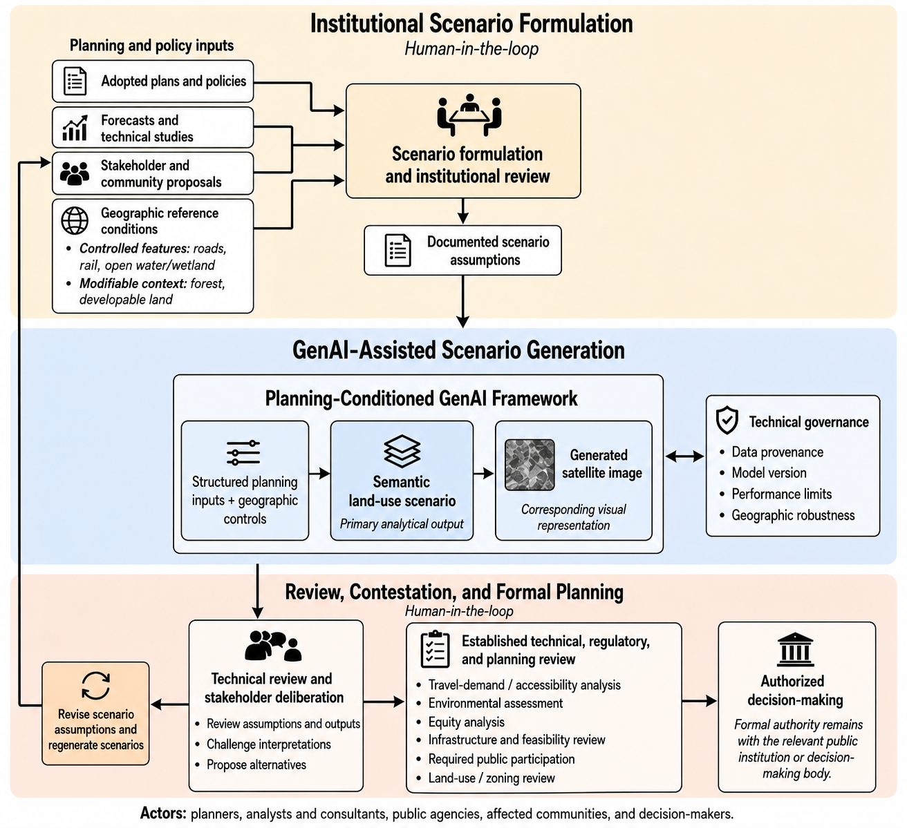
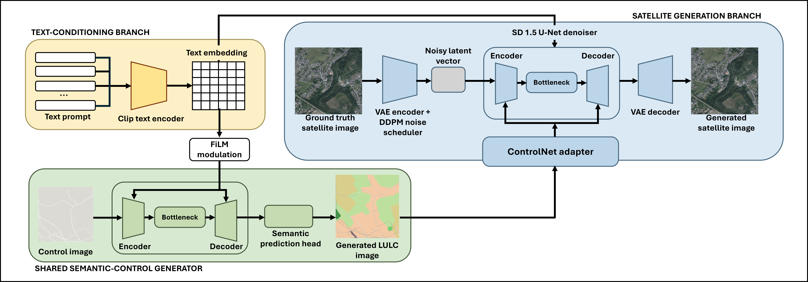
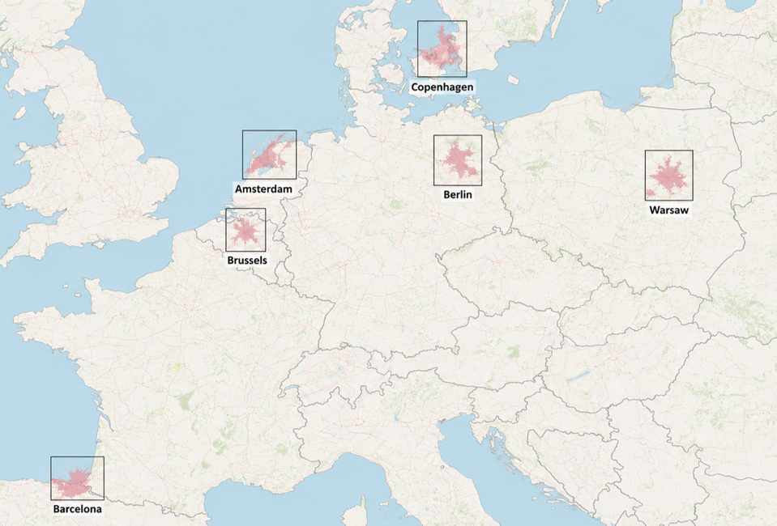

# Planning-Conditioned Generative Framework for Transportation and Land-Use Scenario Planning

This repository implements a two-stage generative workflow for exploring transportation and land-use scenarios. Structured planning prompts and geographic control maps are used to predict a semantic land-use map. A second model uses that map and the prompt to generate a corresponding satellite-style image.

The semantic map is the primary analytical output; the generated image provides a visual representation of the proposed scenario. The code includes training, inference, evaluation, component ablations, geographic generalization experiments, and scenario comparisons.

## Planning workflow

The framework diagram places generation within a broader planning process: institutions and stakeholders formulate assumptions, models produce candidate scenarios, and people review the outputs through established planning procedures. The repository implements the modeling and evaluation components. Institutional review, public participation, regulatory assessment, and formal decisions take place outside the software.

## Model architecture

**Stage 1 — semantic scenario generation.** A CLIP text encoder embeds the structured prompt. A U-Net uses feature-wise linear modulation (FiLM) to combine text conditioning with a geographic control map and predict nine land-use classes. Training combines cross-entropy, Dice, and a semantic walkability proxy loss.

**Stage 2 — satellite-style image generation.** A ControlNet adapter conditions Stable Diffusion 1.5 on the colorized semantic map and the planning prompt. The base text encoder, variational autoencoder (VAE), and diffusion U-Net are frozen during training. The ControlNet adapter is trained using noise-prediction, image reconstruction, and VGG perceptual losses. Training uses reference semantic maps; end-to-end inference uses Stage 1 predictions.

The default image resolution is 512 × 512 pixels. Settings such as learning rates, loss weights, diffusion steps, and the pretrained model identifier are defined in [`src/config.py`](src/config.py).

## Geographic context

The supplied study-area figure identifies six European cities: Barcelona, Amsterdam, Brussels, Copenhagen, Berlin, and Warsaw. The code reads city names and geographic footprints from the user's data manifest; it is not restricted to these six cities. Geographic experiments require sufficient observations and valid spatial metadata.
